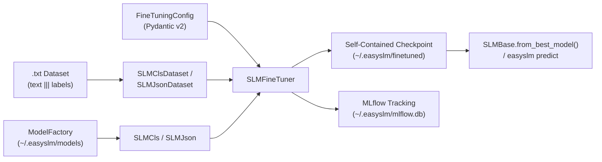

# easySLM

**easySLM** is a lightweight, generic, and production-ready framework for fine-tuning and running inference with **Small Language Models (SLMs)** (e.g., Qwen 2.5, LLaMA 3.2, Gemma 2, SmolLM2) on **single-label** and **multi-label** text classification tasks.

Designed for developer ergonomics and constrained hardware, easySLM runs comfortably on **8 GB VRAM** consumer GPUs via built-in **PEFT (LoRA)**, **Gradient Checkpointing**, **Mixed Precision (`bf16`/`fp16`)**, **Gradient Accumulation**, and **In-Memory Early Stopping**.

---

## Architecture Overview

---

## Core Design Principles

1. **Two Classification Modes, One Unified API**:
   - **Direct Classification (`cls`)**: Backbone hidden states + parametric pooling (`eos`, `mean`, `max`) + `float32` `LayerNorm` + dense `nn.Linear` head.
   - **Generative Classification (`json`)**: `AutoModelForCausalLM` trained with masked prompts (`ignore_index=-100`) to output alphabetically sorted JSON/Python label lists.
2. **Automatic Single-Label & Multi-Label Detection**:
   - Inspects dataset labels automatically (`CrossEntropyLoss` + Softmax vs. `BCEWithLogitsLoss` + Sigmoid).
3. **Single Source of Truth with Pydantic v2**:
   - `FineTuningConfig` validates every parameter (`extra="forbid"`, `validate_assignment=True`) and provides built-in defaults—no external YAML file is required.
4. **CWD-Independent Storage (`~/.easyslm/`)**:
   - Base-model caches, checkpoints, predictions, and MLflow storage default to `~/.easyslm/` (overridable via `EASYSLM_HOME` or per-call arguments).
5. **Self-Contained Checkpoints & Model Cards**:
   - Every training run saves adapters/weights, tokenizer, `easyslm_config.json`, `prompt_config.yml`, diagnostic plots/tables, and a YAML-frontmatter Markdown Model Card for automatic best-model selection.

---

## Where to Go Next

- **[Installation & Storage](getting-started/installation.md)** — Install with `uv` or `pip` and configure `EASYSLM_HOME`.
- **[Minimal Quickstart](tutorials/minimal-quickstart.md)** — Fine-tune and run inference in under 20 lines of code.
- **[Customized Fine-Tuning](tutorials/custom-fine-tuning.md)** — Explore LoRA, pooling strategies, oversampling, early stopping, and JSON mode.
- **[MLflow & Diagnostics](tutorials/mlflow-and-diagnostics.md)** — Track runs and inspect confusion matrices, per-class metrics, and error tables.
- **[API Reference](api/slm.md)** — Full class and method documentation generated from source.
