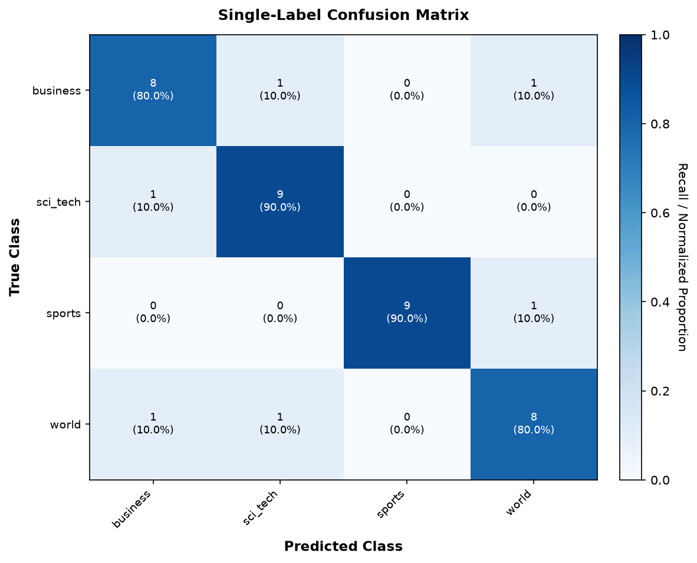
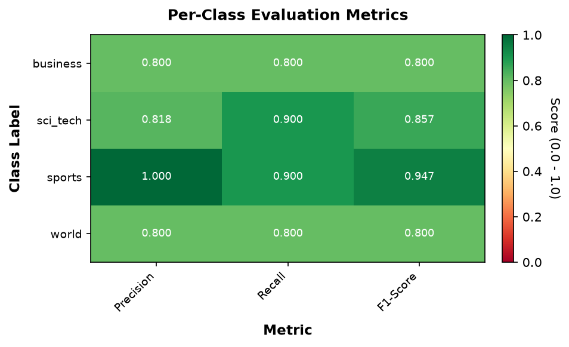
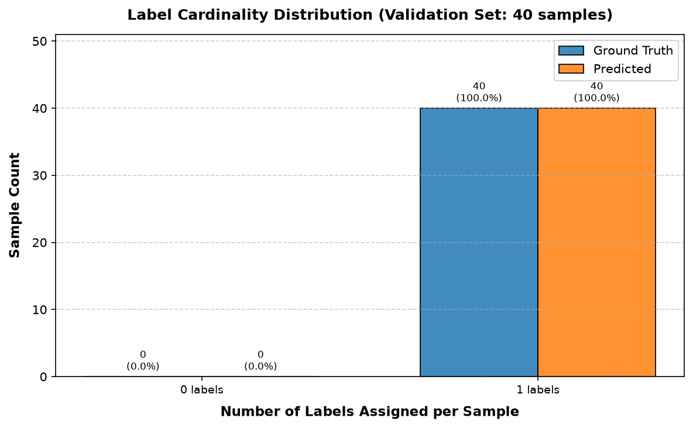

# MLflow Tracking & Diagnostic Plots

When `use_mlflow=True` (the default), `SLMFineTuner` automatically logs parameters, training/validation curves, GPU/system metrics, plots, and tables to `~/.easyslm/mlflow.db` and `~/.easyslm/mlruns`.

---

## 1. Managing MLflow via CLI

```bash
# Start the local MLflow Web UI (http://127.0.0.1:5000)
uv run easyslm mlflow start --port 5000

# Inspect server health, SQLite DB size, and top metrics per experiment
uv run easyslm mlflow status

# List recent runs sorted by F1, loss, or date
uv run easyslm mlflow list --limit 10 --sort-by f1

# Inspect the best run and export its logged artifacts
uv run easyslm mlflow best --metric eval_f1_macro --export-to ./best_run_artifacts

# Clear stored artifacts (or omit --artifacts-only to reset the DB too)
uv run easyslm mlflow clear --artifacts-only
```

---

## 2. Diagnostic Plots Generated Automatically

After every training run, easySLM generates publication-ready plots both inside `<checkpoint_dir>/plots/` and in MLflow (`Artifacts > plots/`).

### Confusion Matrix

For single-label tasks, easySLM plots a row-normalized confusion matrix showing exact counts and recall percentages per class (for multi-label tasks, it generates a **Cross-Label Co-Occurrence Matrix**):



### Per-Class Metrics Heatmap

Displays **Precision**, **Recall**, and **F1** alongside class **Support** for every label, making it easy to spot weak or imbalanced classes:



### Label Cardinality Distribution

Compares the true vs. predicted number of labels per sample—especially useful for diagnosing over- or under-prediction in multi-label tasks:



---

## 3. Structured Evaluation Tables

Alongside the PNGs, easySLM saves machine-readable JSON tables in `<checkpoint_dir>/tables/` (and MLflow `Artifacts > tables/`):

- `confusion_matrix.json` (or `cross_label_confusion_matrix.json`)
- `per_class_metrics.json` (`class_name`, `precision`, `recall`, `f1_score`, `support`, `predicted_count`)
- `label_cardinality.json`
- `validation_errors.json` — Top misclassified validation examples per class (controlled by `max_errors_per_class`), including input text, ground truth, predicted labels, and confidence/error score.
